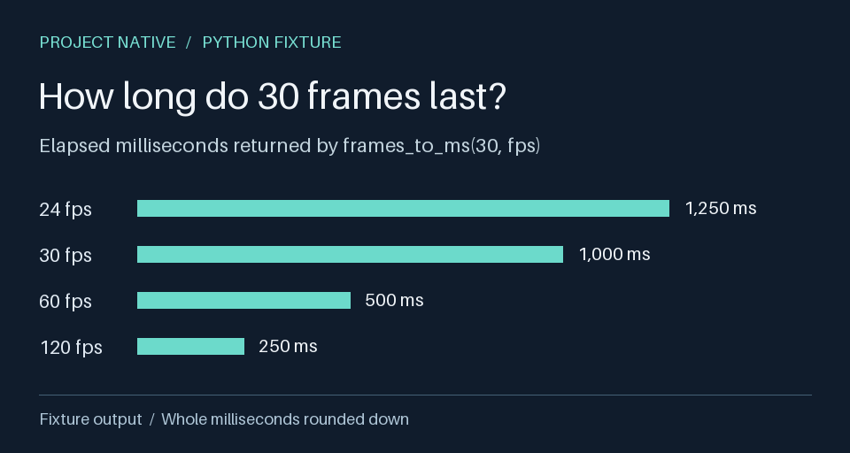

# Project NATIVE

Project NATIVE is a local test project for Codex, Claude Code, and Concord. The Python fixture converts a frame count into milliseconds. The harness uses only the Python standard library.

## GTA VI research

What would it take to run the Xbox Series version of **Grand Theft Auto VI (GTA 6)** on a Windows PC? The [illustrated research guide](research/xbox-to-pc.md) follows an Xbox launch, a resource read, and a rendered frame. Try the [read-only executable inspector](tools/inspect_pe.py) on Windows Notepad to reproduce the first step with Python alone. Game data stays local.

## Windows graphics baseline

Microsoft's GDK desktop sample rendered its first Direct3D 12 frame on the test PC. [Build instructions and verified screenshot](demo/gdk/README.md)

## Public research demo

The JavaScript launcher calls the Python fixture on Windows. The REA pilot records which dependencies a static reviewer recovered and which call needed a runtime check. The research plan tracks the steps from a synthetic manifest to a repeatable PC playability test. [Experiment, reproduction commands, and milestones](research/rea.md)

Run `python demo/pc_scene.py` to move the square with the arrow keys. Run `python demo/pc_scene.py --smoke` to open the same window and test all four directions automatically. Both commands require Python with Tk and a graphical desktop.



## Run the harness

```powershell
cd D:\gta6\ProjectNative
python harness.py
python harness.py --review claude
python harness.py --show RUN_ID
python harness.py --handoff RUN_ID
```

Run `python harness.py` for local tests. When you request a review, the harness runs the tests first and calls the reviewer only if they pass. Use `--review codex` for an independent Codex review, `--review claude` for a Sonnet review, or `--review both` to run both in sequence. To ask Opus one unresolved technical question, run the harness separately with `--escalate "Your question"`.

Each provider call has a 90-second timeout. If your Claude session has expired, renew it with `claude auth login`. The harness removes common API key and provider environment variables from the child process and does not automatically switch to paid API access. Each provider manages subscription quotas and any extra usage enabled on your account.

Pass the run ID printed in the terminal to `--show` to see test output, model responses, and process status. Runs are stored locally in `.native/runs.sqlite3`. An interrupted run can remain marked `running`. Each retry gets a new ID. A successful model command means the harness received a response. Evaluate its findings separately.

For a run from a clean working tree, `--handoff` reports the commit SHA and the status of each step. Add this summary to the Concord task. The SQLite database stays local, so reviewers in another worktree rerun the tests at the same commit. If an older run has no recorded commit, rerun the tests from a clean working tree.

## Codex, Claude Code, and Concord

| Role | When to use it | Expected output |
| --- | --- | --- |
| Codex | Implement small changes, write tests, and integrate reviewed work | Commit, test result, and any open question for the reviewer |
| Claude Code / Sonnet | Give a Codex change its first independent review | Finding with the file and input needed to reproduce it |
| Codex CLI | Review a Sonnet change or provide a second opinion while Sonnet is unavailable | Concise review and a suggested test for a coverage gap |
| Claude Code / Opus | Resolve conflicting reviews or a difficult technical decision | Reasoned answer to one question and a way to verify it |
| Concord | Coordinate file ownership, check for overlaps, track status, and hand off work | Task record with the commit and test evidence |

1. The implementing agent claims the files with `start_work`. A second agent editing concurrently uses a separate worktree and claims its own files.
2. The implementing agent commits the change, runs the tests from the clean working tree, and adds the `--handoff RUN_ID` summary to Concord. If the reviewer is connected, hand over the task with `transfer_work`.
3. The reviewer reads the commit and acceptance criteria with `inspect_work` and records findings in Concord. CLI reviews cover the fixture source. Codex runs in read-only mode, and Claude runs with tools disabled.
4. Fix failing tests locally first. If access or quota limits prevent a model call, record the failure and continue with local tests. Switching providers or escalating to Opus requires an explicit call.

## Local Claude Code plugin and Concord workspace

From the project directory, install OpenAI's official Codex plugin with local scope.

```powershell
claude plugin marketplace add openai/codex-plugin-cc --scope local
claude plugin install codex@openai-codex --scope local
```

Start Claude Code from the project root. Run `/codex:setup` to check the local Codex session. To review a Claude change, run the tests on the feature branch, then run `/codex:review --base main`. Keep the automatic review gate disabled.

The Git repository root is the Concord workspace for NATIVE tasks. If you start a session from the parent directory or a separate worktree, run `concord -C <project-root> status` to get the workspace ID and pass it as `workspace_id` in Concord calls. Claude Code and Codex should see the same NATIVE task when opened from the same project directory.

## Plan for the incoming download

| Timing | Owner | Work and acceptance criteria |
| --- | --- | --- |
| While the download is in progress | Codex | Run `python harness.py` from a clean commit. Once the fixture tests pass, record the run ID and commit in Concord. |
| First 15 minutes after completion | Codex | Check the client's completion status for the selected files and identify any skipped files. List file paths and sizes locally. Record whether the executable exists at the path specified in the manifest. |
| Next 15?60 minutes | Codex | Identify any missing or inconsistent files. If torrent piece verification is needed, measure its duration separately because it depends on disk speed. Piece verification checks the data against the torrent metadata. Verifying publisher provenance requires an independent signature or trusted reference. |
| First development iteration | Codex and Sonnet | Create two sample manifests in the test project. Point one at an existing file and the other at a missing file. Add an automated test showing that the checker accepts the first and reports the missing path for the second. If Sonnet is available, have it review the commit independently. |
| Decision and handoff | Codex | If the executable is missing, mark runtime testing of the package as blocked. If it exists, assess the target platform, provenance, and authorized test environment. Record the inventory and test results separately in either case. |

Keep the raw package and local inventory on the download machine. Use the shared Git repository for project-authored tools, synthetic fixtures, and reproducible tests.

## Verify a compressed-stream boundary

Run `python -m fixture.rpf FILE OFFSET` on a seekable file at a candidate 16-byte-aligned offset. The probe reports two half-open byte ranges when both zlib checksums pass and any intervening alignment bytes are zero. Each stream has a 1 MiB limit for both compressed and decoded sizes. The probe discards decoded bytes. Its output describes stream framing only; archive directory entries and asset types require separate evidence.

Run `python -m unittest fixture.test_rpf -v` for synthetic examples covering good boundaries, incorrect offsets, damaged checksums, truncation, padding, and the expansion limit.

## Test a directory hypothesis

Run `python -m fixture.directory_probe FILE TABLE_START TABLE_END --base 0 --unit 1 --stride 8` to test adjacent little-endian unsigned 32-bit offset and compressed-length fields in a known candidate metadata region. Offsets are relative to the supplied base in units of bytes times the unit argument. Lengths are in bytes. The probe tests four-byte-aligned field positions relative to the beginning of the region.

For a match, two rows one stride apart must predict distinct ordered streams beyond that region, and both zlib end positions and checksums must agree. Exit code 1 means the chosen layout yielded no pair. The probe covers direct zlib records of up to 1 MiB and does not infer an archive directory or identify script bytecode. Run `python -m unittest fixture.test_directory_probe -v` for the synthetic positive and negative controls.

### Choosing an independent RPF9 reference

The upstream container parser reads the header and checks that its two metadata regions are in bounds and divisible into 16-byte slots. That check establishes where a table can fit. It gives no interpretation for the bytes in an individual slot. [Pinned container parser](https://github.com/offs/rpf9-extract/blob/46ca608975b749fc3e77a62435d46fdc115a97e0/src/container.rs)

SixNG reports an encrypted table of contents and describes building its own index by scanning for compressed streams and grouping pages. If two readers both locate an entry through its payload, their agreement supports the stream boundary. A test of directory decoding needs an independently supplied name, stored offset and stored length, ideally from the packer that wrote a redistributable example. Reserve a second entry for verification after choosing the rule. [Pinned SixNG format notes](https://github.com/TrinitronClient/GTA6-Asset-Info/blob/5913fb08d65e20ded90e31402b521bf554c1513c/formats/01-rpf9.md)

Use `python -m fixture.rpf FILE OFFSET --paged` to test a candidate that starts with one or more full 64 KiB decoded pages and ends with a shorter page, or contains just one short page. The stored span includes internal zero padding and ends at the final stream checksum. The probe checks every checksum and accepts up to 256 pages, with at most 65 KiB of compressed input per page. A full page with no valid continuation leaves the extent unverified. This rule measures the extent implied by a framing hypothesis. Confirm the starting offset and the record's identity independently before treating the result as an archive entry.
