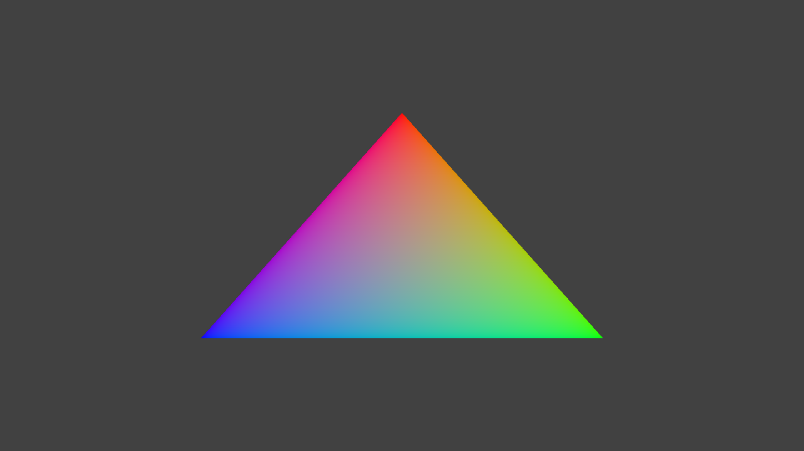

# Direct3D 12 first frame on Windows

Microsoft's SimpleTriangleDesktop draws three colored vertices with Direct3D 12. Project NATIVE builds the pinned desktop sample and saves its first rendered back buffer as a PNG. [Upstream sample](https://github.com/microsoft/Xbox-GDK-Samples/tree/b1e77b6ac10f95b07296025fda171ca2ddc42dbe/Samples/IntroGraphics/SimpleTriangleDesktop)



## Reproduce on Windows

Use an interactive Windows desktop with Direct3D 12, the Xbox Gaming Runtime, Git, PowerShell 7.4+, Visual Studio 2022 C++ x64 build tools (v143), and the Windows SDK with its shader compiler. Use the October 2026 public GDK. This run used its extracted edition directory. The release archive includes Microsoft's SetupScripts/ExtractXboxOneDKs.ps1 for creating an extracted kit. The tested archive SHA-256 was `b5773c5fdf0b5b1af0c35f9b7d22cf27d58c6f3fafd4f61e0e01477e0194480b`. [Microsoft GDK release](https://github.com/microsoft/GDK/releases/tag/October-2026-v2610.0.9661)

From the Project NATIVE root, supply the edition directory containing `windows/include/grdk.h`. If the installed kit sets `GameDKCoreLatest`, omit the parameter.

```powershell
./demo/gdk/build.ps1 -KitRoot 'C:\ExtractedGDK\Microsoft GDK\261000'
./demo/gdk/capture.ps1
```

The build fetches the pinned sample revision and restores its WinPixEventRuntime dependency. The source checkout and build products stay in the current user's local app data. The capture command writes the verified image to `docs/gdk-first-frame.png`.

## What the screenshot verifies

The capture hook runs after the first draw command list is submitted and immediately before the first swap-chain presentation. When the launcher supplies an output path, DirectXTK12 copies the sample's back buffer to a PNG and restores its presentation state. The build script reverses the source patch after compilation. The launcher waits for the sample window, requests a normal close, checks the exit code, and verifies the red, green, and blue regions before copying the PNG.

The tested configuration used GDK 2610.0.9661, MSBuild 17.14.60, Windows SDK 10.0.26100.0 and Release x64 on a PC equipped with an NVIDIA GeForce RTX 3090. The capture measured 1280 × 720. Reproduction on a second machine remains open.
