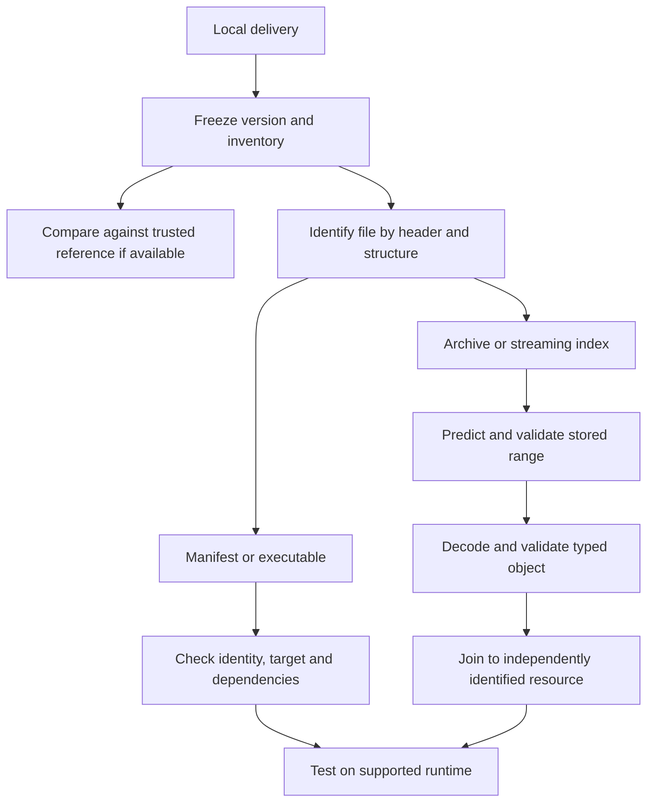

# GTA VI research handbook

**What can I learn without the game files?** Start with what each file can establish. A manifest describes what the platform should launch. An executable contains instructions. A library supplies a narrower interface. An archive groups resources. A shader program runs on a GPU. All five may belong to the same product, yet validating one tells you little about the other four. Project NATIVE has demonstrated static inspection and a desktop Direct3D sample. A GTA VI game frame on Windows remains an open milestone.

Rockstar lists GTA VI for Xbox Series X|S and PlayStation 5. Our Xbox-to-PC investigation is independent. The public comparisons use named tools and published documentation. Original game media, package inventories, and build-specific identifiers stay local. [Rockstar product page](https://www.rockstargames.com/VI)

## Start here, without a download

1. Clone this repository and enter its root. Python 3.9+ is sufficient for the shipped inspection tools. Start with the source files that already exist in the checkout.

   ~~~powershell
   git clone https://github.com/oguzhanozfe/gta-vi-port-research.git
   cd gta-vi-port-research
   python tools/inventory.py tools --sha256
   python tools/inspect_pe.py "$env:WINDIR\System32\notepad.exe"
   python harness.py
   ~~~

2. Read the inventory as a list of relative paths, lengths and optional digests. The second command inspects an installed Windows program without starting it. The harness runs the project's tests. None of these steps needs a game, SDK, GPU capture or cloud account.
3. Follow the [three architecture diagrams](xbox-to-pc.md) from manifest to process, resource to memory, and GPU command to display. Use the [data-type report](data-types.md) for the GTA V baseline, what has been tested and the missing evidence for each GTA VI research question.
4. To reproduce a real desktop graphics result, use the [pinned GDK triangle build and screenshot](../demo/gdk/README.md). To investigate process boundaries with multiple agents, use the [REA pilot and its independently checked results](rea.md).

## How to examine a local delivery

1. **Freeze the delivery.** Finish the transfer and select an immutable copy or filesystem snapshot. If using qBittorrent, a local force recheck verifies agreement with torrent pieces. A publisher-signed catalog or authorized reference is needed to establish publisher provenance.
2. **Create a private ledger.** Run the command below with the output outside the input tree. Default mode reads metadata; `--sha256` reads every regular file. Symlinks and Windows reparse points are skipped. A nonzero exit means the output may be partial. The inventory cannot provide an atomic snapshot of a changing tree.

   ~~~powershell
   $root = Read-Host 'Directory containing your authorized local input'
   New-Item -ItemType Directory -Force .native | Out-Null
   python tools/inventory.py $root --sha256 > .native/inventory.jsonl
   if ($LASTEXITCODE) { throw 'Incomplete inventory' }
   ~~~

3. **Identify the outer layer.** Record extension, magic, byte order and plausible header length. Validate offsets against the parent file before unpacking. Keep object-relative offsets, file offsets and executable RVAs in separate columns.
4. **Choose a tool from the table.** Try one independently identified object. Record the predicted output, the observed output and a failure case. Repeat on a second object before applying the rule to an archive.
5. **Identify the content.** A valid compressed range, a named asset and a resource used during gameplay are three different results. Filenames, marker scans and hash matches generate candidates. A typed field, independent index or observed runtime use can strengthen the identification.
6. **Keep a coverage ledger.** Record bytes read, objects framed, objects decoded, names corroborated, and unresolved cases. A tool rejecting a revision establishes a reader limitation. Unknown data does not become encrypted simply because a decoder rejects it.

## Tool directory

| Question | Tool and input | Useful result | Limitation to record |
|---|---|---|---|
| Which files are here? | [Project inventory CLI](../tools/inventory.py) on a local directory | Stable traversal order and optional per-file SHA-256 | Identity against that snapshot only |
| What would the platform launch? | XML reader on package and game configuration; compare declared path against the ledger | Target family, program and expected path | Plain metadata can be copied. [GDK executable selection](https://learn.microsoft.com/en-us/gaming/gdk/docs/reference/system/microsoftgameconfig/elements/microsoftgameconfig-element-executable) |
| Which libraries does an image reference? | [PE inspector](../tools/inspect_pe.py), then Microsoft DUMPBIN in Developer PowerShell | Architecture, entry RVA, ordinary provider names; DUMPBIN can also list symbols | Dynamic resolution and runtime ABI still need investigation. [DUMPBIN imports](https://learn.microsoft.com/en-us/cpp/build/reference/imports-dumpbin?view=msvc-170) |
| Where does a compressed payload end? | [Stream probe](../fixture/rpf.py) and [two-entry directory probe](../fixture/directory_probe.py) | Checksum, stored range and bounded expansion | A checksum cannot recover a name or establish directory semantics. [Commands](../README.md#verify-a-compressed-stream-boundary) |
| What can the previous game teach us? | CodeWalker for supported GTA V formats; see the [type-by-type source references](data-types.md) | Public examples of maps, drawables, audio banks, cloth, clips and navigation | Validate each candidate layout against the target edition |
| Is a media candidate playable? | [RAD Video Tools](https://www.radgametools.com/binkfaq.htm) for supported Bink revisions; [ffprobe](https://ffmpeg.org/ffprobe.html) and FFmpeg for stream metadata and decode | Frame count, timing, tracks, full decode result | A decodable clip can be a menu video, overlay, or cinematic |
| Is this a song or another audio stream? | [vgmstream](https://vgmstream.org/) for supported bank variants; FFmpeg for an independently supported output | Channels, rate, duration and decodability | Verify music identity separately against structured title or event metadata |
| Does a GPU operation work on PC? | Desktop GDK sample, D3D12 debug layer and [PIX](https://learn.microsoft.com/en-us/windows/pix/gpu-captures/gpu-captures-overview) | Resource bindings, GPU events, readback and frame timing | A working sample measures desktop setup; title compatibility needs a title-rendered frame |
| What about protected packages? | Matching publisher-provided reader, deployment environment or documented platform workflow | Entitled logical reads, or a specific unsupported package state | Platform access does not imply an inner game archive decoder. [GDK packaging modes](https://learn.microsoft.com/en-us/gaming/gdk/docs/features/common/packaging/packaging-packaging-during-development) |

## A repeatable media check

For media you are entitled to inspect, first identify a complete bounded stream in the local archive. Pass an isolated copy to a reader that explicitly supports its revision. Keep source bytes unchanged. When the reader exports MP4, use these independent checks locally:

~~~powershell
$media = Read-Host 'Path to a local converted clip'
ffprobe -v error -show_streams -show_format -of json $media
ffmpeg -v error -xerror -i $media -map '0:v?' -map '0:a?' -f null -
~~~

Check the exit status and compare duration, stream count and frame count with the source index. For audio, also compare channel count, sample rate and total samples, allowing for documented codec delay. Distinct file hashes measure distinct encodings. To count songs, establish track identity separately and preserve alternate edits or duplicates.

## What evidence would change the port assessment?

The first decisive input is an authorized, version-matched executable or buildable engine and gameplay source. The next is a supported reference environment and either a desktop build target or a host that implements the executable's actual platform contracts. A renderer, audio decoder, asset index or static analysis model cannot supply those prerequisites on its own. The [first 72 hours](first-72-hours.md) guide gives owners, acceptance tests and decision points for each route.
